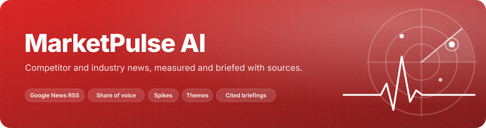
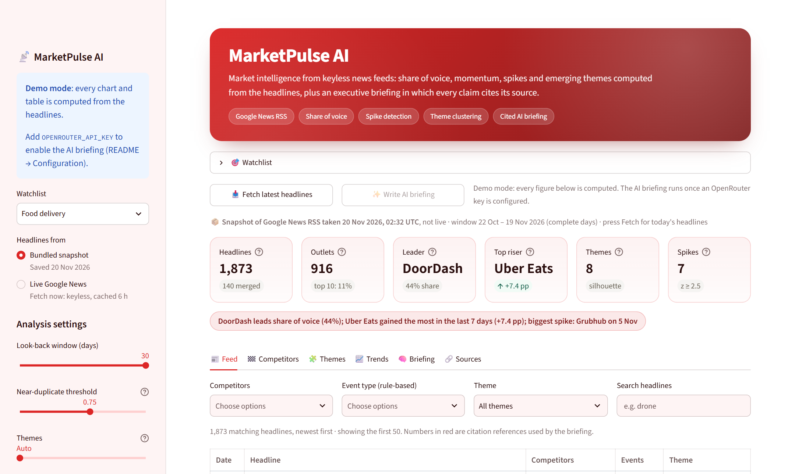
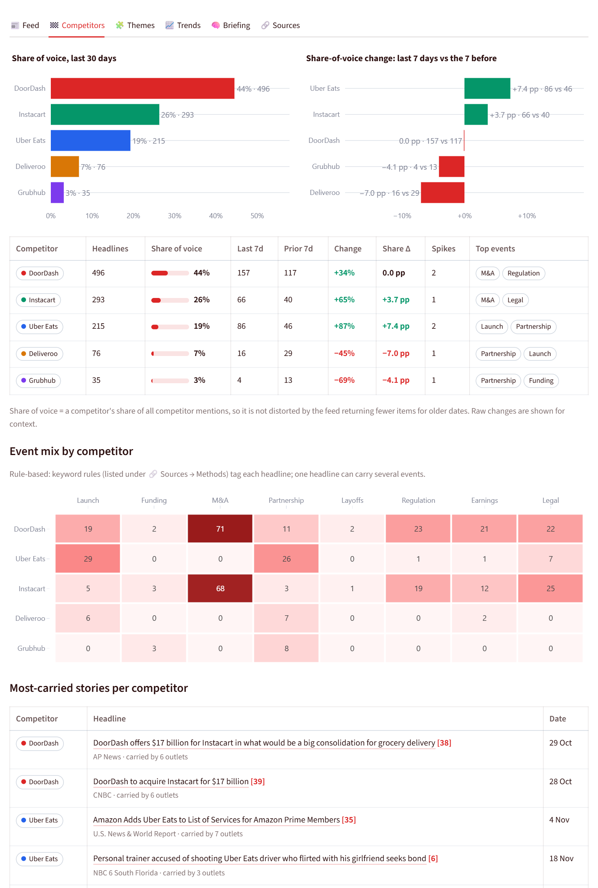
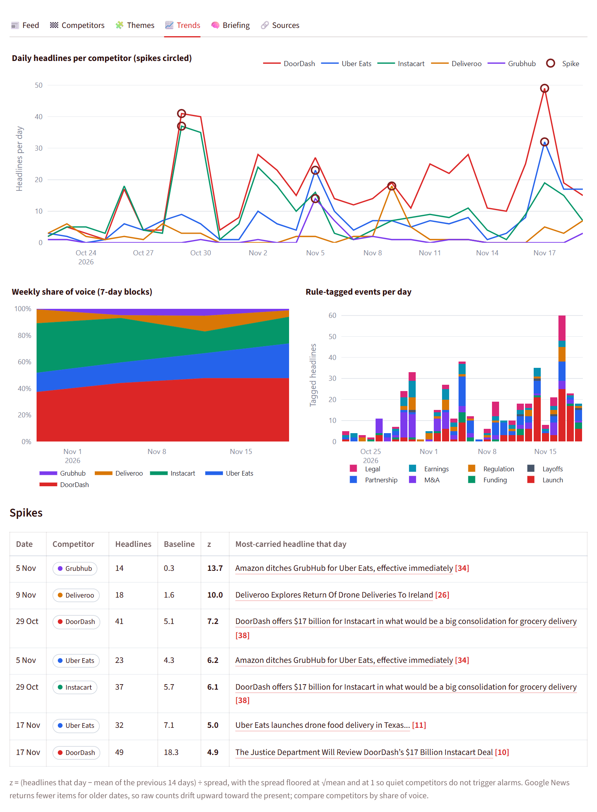
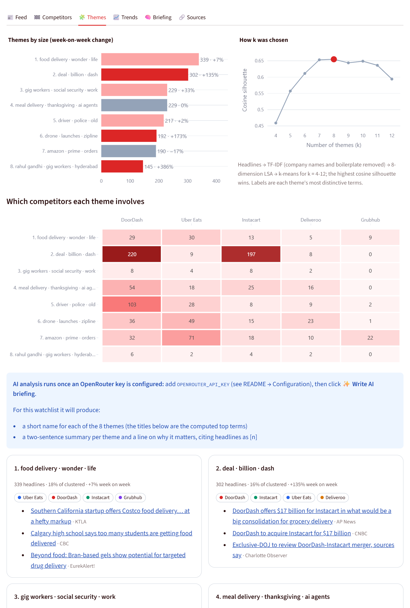
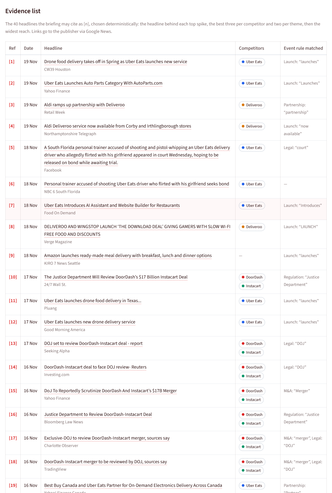
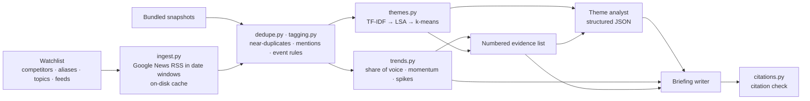

<p align="center">
  
</p>

<p align="center">
  <a href="https://github.com/iamsammy-ak/marketpulse-ai/actions/workflows/ci.yml"></a>
  
  
  
  
  <a href="LICENSE"></a>
</p>

**MarketPulse AI** monitors news about a set of competitors and industry topics. It pulls headlines from
keyless RSS feeds, merges near-duplicate stories, tags which competitors each headline mentions and what kind of event
it reports, then measures share of voice, week-on-week momentum and unusual spikes, and clusters the coverage into
themes. An AI step adds theme summaries and an executive briefing in which every claim cites a numbered headline, and a
deterministic check verifies those citations.

**Every number is computed in Python.** The model only names and summarises themes and writes prose from figures it is
given. The AI features need a free [OpenRouter](https://openrouter.ai/keys) key; without one the app runs in demo
mode, where every chart, table and the downloadable report still work.



## Features

| | |
|---|---|
| 📰 **Feed** | Deduplicated headlines with competitor and event tags, theme, outlet reach, filters, search and CSV export |
| 🏁 **Competitors** | Share of voice, share-of-voice change week on week, event mix per competitor and the most widely carried stories |
| 🧩 **Themes** | Headlines clustered into themes, with the number of themes chosen by silhouette score and shown on a chart |
| 📈 **Trends** | Daily mentions with spikes circled, weekly share of voice, events per day and a spike table that names the likely cause |
| 🧠 **Briefing** | AI briefing (Key moves, Competitor watch, Emerging themes, Risks and opportunities, What to watch) with linked citations and a citation check |
| 🔗 **Sources** | The numbered evidence list, outlet ranking, fetch log (including capped query windows) and the full method notes |
| 🛰️ **Live or saved** | Fetch today's headlines for any watchlist without a key, or explore three bundled snapshots |

## Screenshots

<table>
  <tr>
    <td width="50%"></td>
    <td width="50%"></td>
  </tr>
  <tr>
    <td align="center"><b>Competitors</b>: share of voice, momentum and rule-tagged events</td>
    <td align="center"><b>Trends</b>: daily mentions, spikes and the headline behind each spike</td>
  </tr>
  <tr>
    <td width="50%"></td>
    <td width="50%"></td>
  </tr>
  <tr>
    <td align="center"><b>Themes</b>: clusters, how k was chosen, and which competitors each theme involves</td>
    <td align="center"><b>Sources</b>: the numbered evidence list the briefing must cite</td>
  </tr>
</table>

The screenshots show the bundled *Food delivery* snapshot in demo mode. The Briefing tab needs an OpenRouter key.

## How it works



1. **Ingestion** (`marketpulse/ingest.py`) builds one Google News RSS search per competitor (name OR aliases) and per
   topic, plus any extra RSS or Atom URLs. A Google News query returns at most 100 items, so each query is split into
   date windows; a window that still returns 100 items is flagged as *capped* and its counts are a lower bound.
2. **Deterministic analysis** merges near-duplicates, tags mentions and events, computes trends and themes, and picks a
   numbered evidence list that covers every competitor, theme and top spike.
3. **Theme analyst** returns a name, summary and implication per theme as JSON, validated with Pydantic. Lenient
   validators absorb free-model quirks (`"Theme 3"`, `"[12]"`, objects where strings were expected).
4. **Briefing writer** receives the computed figures, the theme names and the evidence list, and must cite `[n]` in
   every bullet. `citations.py` then checks every reference exists and flags sentences without one.

### Methods

| Step | Method |
|---|---|
| Near-duplicates | TF-IDF cosine on titles (unigrams and bigrams, stop words removed) ≥ 0.75, published within 3 days **and mentioning the same competitors**; union-find groups keep the earliest headline and record how many outlets carried it |
| Mentions | Name or alias as a whole word, ignoring case but requiring a capital first letter; aliases of ≤ 3 letters or in capitals match exactly; `-phrase` exclusions are blanked out first |
| Events | Keyword rules for Launch, Funding, M&A, Partnership, Layoffs, Regulation, Earnings and Legal, listed in the app; each tag shows the words that triggered it |
| Share of voice | A competitor's mentions ÷ all competitor mentions in the window |
| Momentum | Last 7 days vs the 7 before: headline change in % and share-of-voice change in percentage points |
| Spikes | z = (count − mean of previous 14 days) ÷ max(SD, √mean, 1); flagged when z ≥ 2.5 and count ≥ 3, after 7 days of history |
| Themes | TF-IDF (company names, market-data boilerplate and terms in > 20% of headlines removed) → truncated SVD to 8 dimensions → k-means for k = 4-12 → highest cosine silhouette; labels are the three terms with the largest lift over the corpus |
| Evidence list | Headline behind each top spike, best 3 per competitor, best 2 per theme, then by score = ln(1 + copies) + 0.6·event + 0.4·mention + 0.5·recency |
| Citation check | Every `[n]` must be in the evidence list; sentences of four or more words without a citation are flagged |

Two findings from the real feeds shaped these choices. Templated headlines ("Why Nvidia stock is falling today" /
"Why AMD stock is falling today") are textually near-identical, so near-duplicates must also mention the same
competitors. And Google News returns fewer items for older dates, so raw counts drift upward toward the present; the
app ranks movers by share-of-voice change, which compares competitors within the same feed.

### Data

| Snapshot | Competitors | Topics | Headlines (unique, 22 Oct – 19 Nov 2026) |
|---|---|---|---:|
| Food delivery | DoorDash, Uber Eats, Instacart, Deliveroo, Grubhub | food delivery, gig workers | 1,873 |
| AI chips | Nvidia, AMD, Intel, Qualcomm, Broadcom | AI chips, chip export controls | 5,087 |
| Electric vehicles | Tesla, BYD, Rivian, Lucid, Polestar | electric vehicles, EV charging | 4,345 |

The snapshots were fetched once from Google News RSS on 20 Nov 2026 by `scripts/snapshot.py` (2-day windows, two
requests at a time with a pause) and are labelled with that date in the app. They store only the title, outlet, link,
publication time and the feed's short summary, never article text. If fetching fails, the script writes a seeded
**synthetic** snapshot with fictional companies instead (`marketpulse/synthetic.py`, assumptions in its docstring),
and the app labels it as synthetic. The test suite uses the same generator because its planted spike and riser are known.

### Built for free models

OpenRouter's free models are rate-limited, so the client in `marketpulse/llm.py`:

- tries a list of models in order and **skips a busy model** instead of retrying it, saving the daily quota;
- **caches** every successful reply on disk, keyed by a hash of the request, so a repeat run costs nothing;
- validates JSON against the schema and **repairs once** when a reply is malformed or cut off;
- keeps the AI step to **two calls** per briefing (theme notes, then the briefing); headline tone is a separate,
  optional call;
- supports saved analyses in `demo/analyses/` (generated by `scripts/build_demo.py`) so a deployment can show AI
  output without a key.

## Quick start

```bash
git clone https://github.com/iamsammy-ak/marketpulse-ai.git
cd marketpulse-ai
python -m venv .venv
source .venv/bin/activate        # Windows: .venv\Scripts\activate
pip install -r requirements.txt
streamlit run app.py
```

The app opens on the bundled *Food delivery* snapshot in demo mode. Pick **Custom watchlist** in the sidebar, enter
competitors (one per line, `Name: alias, alias, -excluded phrase`) and press **Fetch latest headlines** to analyse
today's news. Fetching needs no key.

## Configuration

AI features (theme summaries, the briefing and headline tone) need a free key from
[openrouter.ai/keys](https://openrouter.ai/keys). Copy `.env.example` to `.env`:

| Variable | Purpose |
|---|---|
| `OPENROUTER_API_KEY` | Enables the AI briefing, theme summaries and headline tone |
| `OPENROUTER_MODELS` | Optional comma-separated model list, tried in order |

Then press **✨ Write AI briefing**. To bundle AI output for the snapshots, run `python scripts/build_demo.py`.

### Deploy on Streamlit Community Cloud

1. Fork this repository.
2. At [share.streamlit.io](https://share.streamlit.io), create an app pointing at `app.py`.
3. Under **Settings → Secrets**, add `OPENROUTER_API_KEY = "your-key"` (optional: without it the app runs in demo mode).

## Project structure

```
marketpulse-ai/
├── app.py                    Streamlit interface
├── marketpulse/
│   ├── ingest.py             Google News / RSS fetching, date windows, cache, parsing
│   ├── dedupe.py             normalisation and near-duplicate merging
│   ├── tagging.py            competitor mentions and rule-based event tags
│   ├── trends.py             daily counts, share of voice, momentum, spikes
│   ├── themes.py             TF-IDF + LSA + k-means with silhouette-chosen k
│   ├── citations.py          citation parsing and checking
│   ├── pipeline.py           analysis glue, evidence list, fingerprints, AI inputs
│   ├── agents.py             theme, briefing and tone prompts
│   ├── llm.py                OpenRouter client: fallback, cache, JSON repair
│   ├── schemas.py            Pydantic models with lenient validators
│   ├── report.py             Markdown briefing export
│   ├── synthetic.py          seeded fallback dataset (fictional companies)
│   ├── charts.py · ui.py     Plotly figures and styling
│   └── demo.py · watchlist.py  snapshots, saved analyses, watchlist parsing
├── demo/                     snapshots/ (gzipped JSON) and analyses/
├── scripts/                  snapshot.py (fetch snapshots), build_demo.py (saved AI analyses)
└── tests/                    unit tests plus a headless run of the whole UI
```

## Testing

```bash
pip install pytest ruff
ruff check . && pytest
```

The suite covers feed parsing and windowing against a bundled RSS fixture, the disk cache, near-duplicate merging
(including the same-competitor rule), mention and event rules, share of voice, momentum, spike detection, theme
recovery on a corpus with planted topics, the citation checker, JSON extraction, schema coercion and caching with a
fake model, and runs the full Streamlit app headlessly for every snapshot and a custom watchlist (with a faked fetcher,
so nothing touches the network). CI runs it on every push.

## Limitations

- Analysis uses headline metadata only. Google News search is a sample of coverage: at most 100 items per query
  window, and fewer items for older dates.
- Event tags are keyword rules, so they miss paraphrases and sometimes fire on unrelated uses of a word.
- Ambiguous names need care: "Lucid" also matches an investment bank, which is why exclusions exist.
- Themes are built from short headlines; a theme can mix loosely related stories, and computed labels are terms, not
  names.
- The citation check proves that each cited headline exists, not that it supports the sentence.
- Google News RSS is offered for personal, non-commercial use; check its terms before building on it.
- AI-written text can be wrong. MarketPulse is a monitoring aid, not investment advice.

## Roadmap

- [ ] Scheduled daily fetches that build a history, so trends no longer depend on feed recency
- [ ] Claim-support check: compare each cited sentence with the headline it cites
- [ ] Context rules for ambiguous names (required or forbidden co-occurring words)
- [ ] Email or Slack digest of new spikes

## License

[MIT](LICENSE) © 2026 Abhishek Kumar
